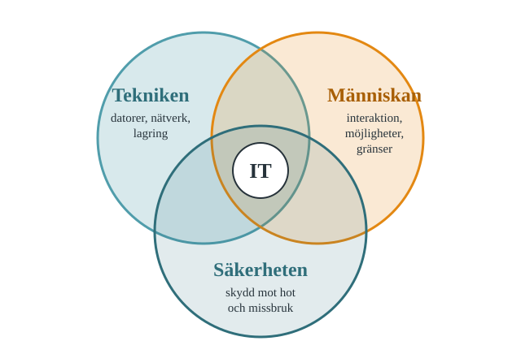
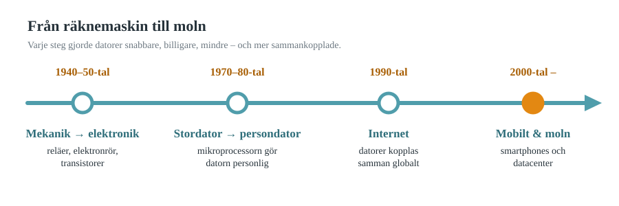
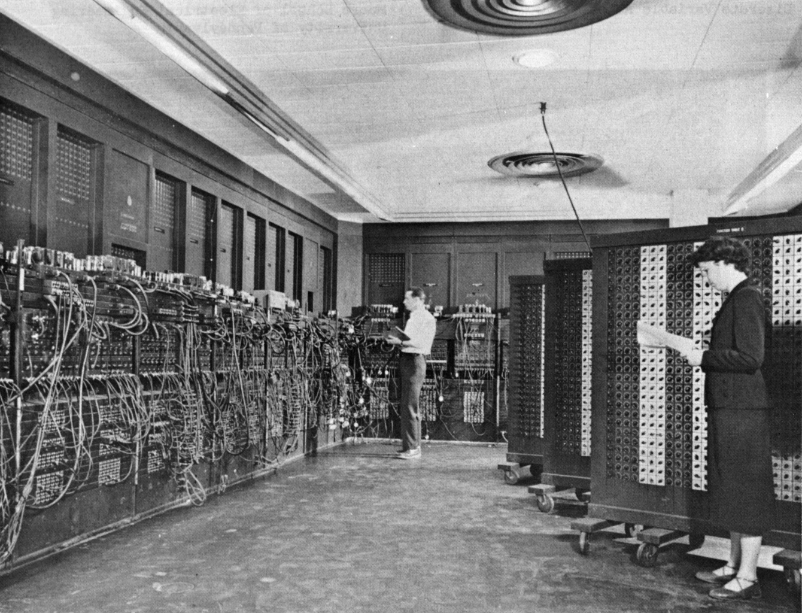
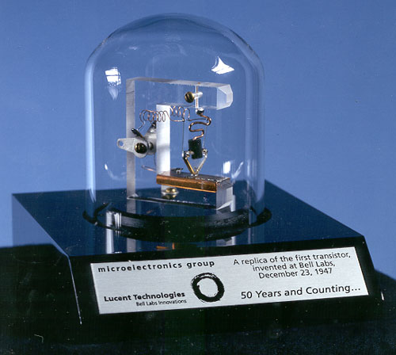
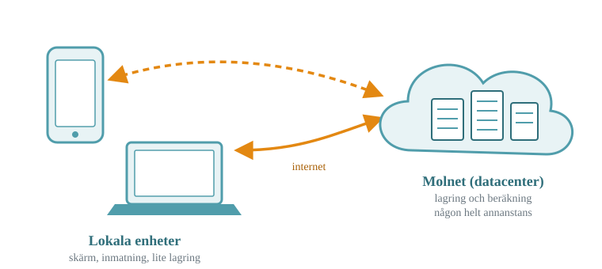

# Introduktion till informationsteknik

::: {.callout-note appearance="minimal"}
**Centralt innehåll som behandlas i detta kapitel**

- Informationsteknikens utveckling samt digitaliseringens effekter på individ och samhälle.
:::

## Vad är informationsteknik?

Informationsteknik (IT) handlar om hur vi skapar, lagrar, bearbetar och delar information med hjälp av digital teknik — datorer, nätverk, mjukvara och de infrastrukturer som binder samman allt detta. Termen används ofta tillsammans med eller utbytbart mot *IKT* (informations- och kommunikationsteknik), där kommunikationsdelen betonar hur information förflyttas mellan människor och system.

I den här kursen kommer du att arbeta med IT ur tre perspektiv som återkommer genom hela boken (@fig-perspektiv):

- **Tekniken i sig** — hur datorer, nätverk och lagringssystem är uppbyggda och fungerar.
- **Människan och tekniken** — hur vi interagerar med digitala system, och vilka möjligheter och begränsningar det innebär.
- **Säkerheten** — hur vi skyddar information och system från hot och missbruk.

{#fig-perspektiv width="70%" fig-alt="Venndiagram med tre överlappande cirklar: Tekniken, Människan och Säkerheten, med IT i mitten."}

## En kort historik över informationstekniken

Att förstå var vi kommer ifrån gör det lättare att förstå varför dagens IT-system ser ut som de gör. @fig-tidslinje ger en översikt över de fyra stora stegen.

{#fig-tidslinje fig-alt="Tidslinje: 1940–50-tal mekanik till elektronik, 1970–80-tal stordator till persondator, 1990-tal internet, 2000-tal mobilt och moln."}

**Från mekanik till elektronik.** De första räknemaskinerna var mekaniska. Under 1900-talets mitt ersattes mekaniska komponenter successivt av elektroniska — först med reläer och elektronrör, sedan med transistorer och till sist med integrerade kretsar. Varje steg gjorde datorerna snabbare, billigare och mindre.

::: {layout-ncol=2 .foto}
{#fig-eniac fig-alt="Svartvitt foto av två personer som programmerar den rumsstora datorn ENIAC."}

{#fig-transistor fig-alt="Kopia av den första transistorn: en liten kristall med metallkontakter under en plastkil."}
:::

::: {.bildkalla}
Bilder: U.S. Army Photo (ENIAC) och U.S. federal government (transistor), public domain, via Wikimedia Commons.
:::

**Från stordatorer till persondatorer.** Fram till 1970-talet var datorer stora, dyra maskiner som delades av många användare samtidigt (så kallad *time-sharing*). Med mikroprocessorns intåg blev det möjligt att bygga persondatorer — datorer som en enskild person kunde äga och använda själv. Detta var en förutsättning för att IT skulle bli en del av vardagen snarare än enbart en resurs för stora organisationer.

**Från isolerade datorer till internet.** Persondatorer som inte kan kommunicera med varandra har begränsat värde. Utvecklingen av nätverksteknik — och till sist internet, som växte fram ur forskningsprojekt under 1960–1980-talen — gjorde det möjligt att koppla samman datorer världen över. Detta är den enskilt viktigaste förutsättningen för dagens digitala samhälle.

**Från stationära datorer till mobilitet och moln.** De senaste decennierna har präglats av två parallella trender: dels att datorkraft har blivit bärbar och ständigt närvarande (smartphones, surfplattor, wearables), dels att lagring och beräkning i allt högre grad flyttat från den enskilda enheten till centraliserade datacenter — *molnet*. Idag är det ofta en kombination: en lokal enhet som är ett fönster mot resurser som egentligen finns någon helt annanstans (@fig-moln).

{#fig-moln width="80%" fig-alt="Mobil och bärbar dator kopplade via internet till ett moln med servrar."}

::: {.reflektera}
Tänk på din egen mobil. Vilka av dina appar skulle fortfarande fungera om den tappade all internetuppkoppling i en vecka?
:::

## Digitaliseringens effekter på individen

Digitaliseringen har förändrat vardagen på sätt som är lätta att ta för givna. Några exempel att reflektera kring:

- **Tillgång till information.** Kunskap som tidigare krävde ett bibliotek eller en expert finns nu ofta tillgänglig direkt, vilket förändrar hur vi lär oss och fattar beslut.
- **Kommunikation.** Avstånd spelar mindre roll för vem vi kan nå och hur snabbt. Samtidigt förändras kommunikationens karaktär — färre telefonsamtal, mer skriftlig, asynkron kommunikation.
- **Arbete och lärande.** Distansarbete, digitala läromedel och nya yrkesroller (många av dem inom IT) hade inte varit möjliga utan digitaliseringen.
- **Identitet och integritet.** Vi lämnar digitala spår i princip konstant. Det väcker frågor om vem som äger och kontrollerar information om oss — något vi återkommer till i kapitlet om it-säkerhet.

## Digitaliseringens effekter på samhället

På samhällsnivå syns digitaliseringens effekter bland annat i:

- **Ekonomi.** Nya affärsmodeller (plattformsekonomi, e-handel, prenumerationstjänster) hade varit omöjliga utan robust IT-infrastruktur.
- **Demokrati och offentlig sektor.** Digitala tjänster (som svenska e-legitimationer och myndigheters e-tjänster) förändrar hur medborgare möter samhället — med både ökad tillgänglighet och nya krav på digital kompetens för att kunna delta fullt ut.
- **Hållbarhet.** Digital teknik kan både bidra till minskad resursförbrukning (färre transporter, effektivare processer) och orsaka ökad förbrukning (energikrävande datacenter, kortare livslängd på hårdvara, elektronikavfall). Detta är en avvägning som återkommer i flera av kursens moment.
- **Sårbarhet.** Ju mer ett samhälle är beroende av digital infrastruktur, desto större blir konsekvenserna när den infrastrukturen fallerar eller angrips — vilket är en del av bakgrunden till varför it-säkerhet är ett eget spår i denna kurs.

## Övningar

1. Lista tre digitala tjänster du använde under det senaste dygnet. För var och en: vad hade du behövt göra istället om tjänsten inte funnits?
2. Välj ett av utvecklingsstegen i @fig-tidslinje (till exempel övergången till internet, eller till molntjänster). Diskutera i par: vilken **möjlighet** öppnade detta steg, och vilken ny **sårbarhet** eller **begränsning** införde det samtidigt?
3. Ta reda på ett exempel på en digital tjänst som förbättrat tillgängligheten till samhället för en grupp människor (till exempel personer med funktionsnedsättning, eller nyanlända). Presentera kort för gruppen.
