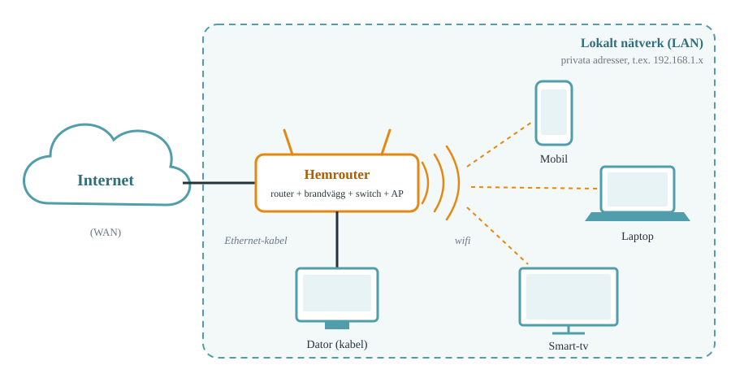
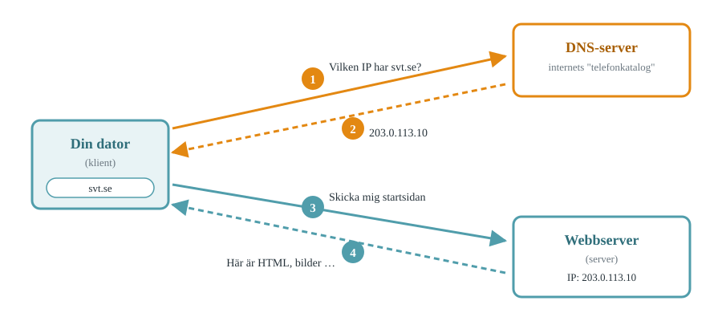

# IT-infrastrukturens uppbyggnad

::: {.callout-note appearance="minimal"}
**Centralt innehåll som behandlas i detta kapitel**

- It-infrastrukturens olika delar samt hur de samverkar och kommunicerar.
:::

## Vad är it-infrastruktur?

När du öppnar en app på mobilen och den laddar dina meddelanden på en halv sekund är det lätt att tro att allt händer i telefonen. I själva verket har din förfrågan just passerat en router, kanske en mobilmast, flera kablar under mark och hav, och hamnat i en server i ett datacenter, och svaret har tagit samma väg tillbaka. Allt det som gör den resan möjlig kallas **it-infrastruktur**.

It-infrastruktur är samlingsnamnet för den hårdvara, mjukvara och de regler som gör att datorer kan lagra, bearbeta och utbyta information. Man kan jämföra med vägnätet: vägar, korsningar, trafikljus och trafikregler är inte själva målet med resan, men utan dem kommer ingen fram.

De viktigaste delarna är:

- **Klienter** — de enheter som användare arbetar med: datorer, mobiler, surfplattor, smart-tv. En klient *ber om* något.
- **Servrar** — datorer vars uppgift är att *tillhandahålla* tjänster åt andra: webbsidor, e-post, filer, spel, video. En server står ofta i ett datacenter och har varken skärm eller tangentbord.
- **Nätverk** — förbindelserna mellan enheterna, både den fysiska delen (kablar, radiovågor, nätverksutrustning) och den logiska (adresser och vägval).
- **Protokoll** — de gemensamma reglerna för *hur* kommunikationen går till. Två enheter som inte följer samma protokoll kan inte förstå varandra, på samma sätt som två personer utan gemensamt språk.

### Olika storlekar på nätverk

Nätverk delas ofta in efter hur stort område de täcker:

| Typ | Betyder | Exempel |
|---|---|---|
| **PAN** | Personal Area Network | Mobilen kopplad till trådlösa hörlurar via Bluetooth |
| **LAN** | Local Area Network | Nätverket hemma, i ett klassrum eller på ett kontor |
| **WAN** | Wide Area Network | Nätverk som binder samman LAN över stora avstånd. Internet är det största WAN:et |

Internet är alltså inte *ett* nätverk utan ett nätverk av nätverk: miljontals LAN som är sammankopplade via internetleverantörer och stora stamnät.

## Nätverkets grundbyggstenar

Ett nätverk består av flera typer av utrustning med olika uppgifter. I företag är de ofta separata lådor; hemma är de nästan alltid inbyggda i en och samma apparat.

**Switch.** En switch kopplar ihop enheter *inom* samma lokala nätverk. Den håller reda på vilken enhet som sitter i vilken port och skickar varje meddelande bara dit det ska, istället för till alla. En switch är som en postsorterare inne i ett och samma hus.

**Router.** En router kopplar ihop *olika* nätverk med varandra, till exempel ditt hemnätverk med internet. Den läser mottagaradressen på varje datapaket och väljer vart paketet ska skickas vidare. Routern är som postkontoret som avgör om ett brev ska till grannhuset eller till ett annat land.

**Brandvägg.** En brandvägg granskar trafiken som passerar in och ut ur ett nätverk och blockerar sådant som inte är tillåtet enligt dess regler. Den kan vara en egen enhet, en funktion i routern eller ett program på datorn. Vi återkommer till brandväggar i kapitlen om it-säkerhet.

**Accesspunkt (AP).** En accesspunkt gör det möjligt att ansluta trådlöst via wifi. Den tar emot radiosignaler från enheterna och kopplar in dem i det trådbundna nätverket. I en skola sitter det ofta en accesspunkt i taket i varje korridor.

**Modem.** Ett modem omvandlar signalen från internetleverantörens ledning (fiber, koppar eller mobilnät) till en form som det lokala nätverket kan använda. Med fiber kallas boxen ofta *mediaomvandlare*.

### Hemrouter: allt i en låda

Den apparat som hemma kallas "routern" innehåller i regel en router, en enkel brandvägg, en liten switch med några nätverksportar och en accesspunkt för wifi, ibland även modemet. @fig-hemnatverk visar hur ett typiskt hemnätverk hänger ihop.

{#fig-hemnatverk fig-alt="Diagram: internet kopplat till en hemrouter. Från routern går en kabel till en stationär dator och wifi till mobil, laptop och smart-tv. Allt utom internet ligger inom en ram märkt lokalt nätverk."}

::: {.callout-tip}
## Kabel eller wifi?
En nätverkskabel ger nästan alltid stabilare och snabbare förbindelse än wifi, eftersom radiosignaler störs av väggar, avstånd och grannarnas nätverk. Spelar du onlinespel eller har videomöten och sitter nära routern är kabel ofta värt besväret.
:::

## Hur enheter kommunicerar

### Datapaket

Information skickas inte som en enda lång ström genom nätet. Den delas upp i små **paket**, ofta runt 1 500 byte styck. Varje paket får en etikett med avsändare, mottagare och ordningsnummer. Paketen kan ta olika vägar genom nätet och sätts ihop i rätt ordning hos mottagaren. Om ett paket försvinner på vägen kan just det paketet skickas om, utan att allt behöver börja från början.

### IP-adresser

För att paketen ska hitta rätt måste varje enhet ha en adress. Den kallas **IP-adress** (IP = *Internet Protocol*). En IPv4-adress består av fyra tal mellan 0 och 255, till exempel:

```
192.168.1.23
```

Fyra sådana tal ger drygt 4 miljarder möjliga adresser. Det låter mycket, men räcker inte till alla världens enheter. Därför finns två lösningar som du stöter på dagligen:

- **Privata adresser.** Inom ett LAN används adresser som bara gäller lokalt, oftast `192.168.x.x` eller `10.x.x.x`. Samma privata adress kan alltså finnas i miljontals hem samtidigt.
- **NAT** (*Network Address Translation*). Hemroutern har *en* publik adress utåt mot internet och översätter mellan den och alla privata adresser innanför. För omvärlden ser hela ditt hushåll ut som en enda enhet.

Den nyare versionen **IPv6** har så många adresser att varje enhet på jorden kan få en egen publik adress med enorm marginal. En IPv6-adress ser ut så här: `2001:db8:85a3::8a2e:370:7334`.

Du behöver sällan ställa in adresser själv. När en enhet ansluter till ett nätverk frågar den automatiskt routern efter en adress via ett protokoll som heter **DHCP**. Routern delar ut en ledig adress och berättar samtidigt vilken router som är *standardgateway* (utgången mot andra nätverk) och vilken DNS-server enheten ska använda.

::: {.callout-important}
## Tre adresser att känna igen
- `192.168.x.x` eller `10.x.x.x` — privat adress i ett lokalt nätverk
- `127.0.0.1` — "den här datorn själv" (kallas *localhost*)
- `169.254.x.x` — enheten fick ingen adress av DHCP. Om du ser den här är något fel med anslutningen.
:::

### DNS — internets telefonkatalog

Människor kommer ihåg namn som `svt.se`, datorer behöver siffror. **DNS** (*Domain Name System*) är tjänsten som översätter domännamn till IP-adresser. Varje gång du skriver en webbadress frågar din dator först en DNS-server vilken IP-adress som hör till namnet. Svaret sparas en stund i datorn, så att nästa besök går snabbare.

Om DNS slutar fungera upplever användarna det som att "internet ligger nere", trots att alla kablar och servrar fungerar. Enheterna hittar helt enkelt inte fram.

### Klient–server-modellen

Det mesta på internet bygger på samma mönster: en **klient** skickar en *förfrågan* och en **server** skickar ett *svar*. @fig-dns visar vad som händer när du skriver `svt.se` i webbläsaren.

{#fig-dns fig-alt="Diagram med fyra numrerade pilar: datorn frågar en DNS-server om IP-adressen för svt.se, får ett svar, skickar sedan en förfrågan till webbservern och får tillbaka webbsidan."}

Steg 3 och 4 följer protokollet **HTTPS**, som bestämmer hur förfrågningar och svar ska se ut och att trafiken ska vara krypterad. En enda webbsida kräver ofta hundratals sådana förfrågningar: en för HTML-koden, och sedan en för varje bild, typsnitt, skript och annons.

Samma modell gäller för e-post, molnlagring, streaming och de flesta spel. Det som skiljer är vilket protokoll som används och vilken sorts server som svarar.

### Portar

En server kan köra många tjänster samtidigt, till exempel både webb och e-post. För att paket ska hamna hos rätt tjänst används **portnummer**. IP-adressen anger *vilken dator*, porten anger *vilken tjänst* på datorn, ungefär som gatuadress och lägenhetsnummer.

| Port | Tjänst |
|---|---|
| 53 | DNS |
| 80 | HTTP (okrypterad webb) |
| 443 | HTTPS (krypterad webb) |

::: {.reflektera}
Din dator har en privat adress som `192.168.1.23`. Hur kan svaret från en webbserver på andra sidan jorden hitta tillbaka till just din dator, när tusentals andra hem har exakt samma adress?
:::

## Övningar

1. Förklara med egna ord skillnaden mellan en **switch** och en **router**. Använd gärna en liknelse.
2. Varför räcker inte IPv4-adresserna till alla enheter i världen, och vilka två lösningar används idag?
3. En klasskamrat säger: "Internet ligger nere, men Discord fungerar fortfarande." Vad kan vara fel? Ge minst två förklaringar.
4. Beskriv steg för steg vad som händer från att du skriver `youtube.com` i webbläsaren till att sidan visas. Använd begreppen *klient*, *server*, *DNS*, *IP-adress* och *paket*.
5. Varför kan det vara klokt att en skola har separata wifi-nät för elever, personal och gäster?

## Laborationer

I laborationerna arbetar du med riktiga verktyg som nätverkstekniker använder varje dag. Skriv ner dina resultat i ett dokument med en rubrik per laboration.

::: {.callout-warning}
## Spelregler
Undersök bara nätverk och utrustning som du själv äger eller har uttryckligt tillstånd att undersöka. Att logga in på någon annans utrustning utan lov är dataintrång, ett brott enligt svensk lag. Att skanna eller testa skolans nätverk bryter mot skolans regler även om det inte alltid är ett brott. Kommandona i laborationerna nedan är ofarliga och tillåtna.
:::

### Lab 1: Din dators nätverksidentitet

**Mål:** Ta reda på vilken IP-adress, standardgateway och DNS-server din dator använder.

Öppna en terminal (Windows: sök på `cmd` eller *Terminal*. Mac: *Terminal* under Program → Verktygsprogram).

::: {.panel-tabset}
## Windows
```
ipconfig /all
```
Leta under det nätverkskort du använder (oftast *Wi-Fi* eller *Ethernet*).

## macOS
```
ipconfig getifaddr en0
route -n get default
scutil --dns | grep nameserver
```
Den första raden ger IP-adressen, den andra standardgatewayen (raden `gateway:`), den tredje DNS-servrarna.
:::

Fyll i tabellen:

| Uppgift | Ditt värde |
|---|---|
| IP-adress (IPv4) | |
| Är adressen privat eller publik? | |
| Standardgateway | |
| DNS-server | |
| Fysisk adress (MAC) | |

Sök sedan på *what is my IP* i webbläsaren. Jämför adressen du får med den i tabellen. Varför skiljer de sig? Koppla till begreppet NAT.

### Lab 2: Ping — finns du där?

**Mål:** Mäta hur lång tid det tar för ett paket att nå en annan dator och tillbaka.

`ping` skickar ett litet paket och mäter svarstiden i millisekunder (ms).

::: {.panel-tabset}
## Windows
```
ping 127.0.0.1
ping <din standardgateway>
ping svt.se
ping google.com
```

## macOS
```
ping -c 4 127.0.0.1
ping -c 4 <din standardgateway>
ping -c 4 svt.se
ping -c 4 google.com
```
:::

1. Notera medelsvarstiden för varje mål.
2. Ordna målen från snabbast till långsammast. Förklara ordningen. Varför svarar `127.0.0.1` snabbast?
3. Pinga en server som ligger långt bort, till exempel en universitetssida i Australien (`unimelb.edu.au`) eller Japan (`u-tokyo.ac.jp`). Ljus i en fiberkabel färdas ungefär 200 000 km/s. Uppskatta avståndet till servern och beräkna den teoretiskt snabbaste svarstiden fram och tillbaka. Hur nära kommer den uppmätta tiden?

::: {.callout-tip}
## Inget svar?
Många nätverk och servrar blockerar ping av säkerhetsskäl. Får du *Request timed out* betyder det inte nödvändigtvis att servern är nere. Prova ett annat mål.
:::

### Lab 3: Traceroute — paketens resväg

**Mål:** Se vilka routrar ett paket passerar på vägen till en server.

::: {.panel-tabset}
## Windows
```
tracert svt.se
```

## macOS
```
traceroute svt.se
```
:::

Varje rad är ett "hopp", det vill säga en router på vägen.

1. Hur många hopp tar det att nå `svt.se`? Och en server i ett annat land?
2. Vilket hopp är din egen hemrouter eller skolans router? Hur vet du det?
3. Vid något hopp brukar svarstiden öka kraftigt. Vad tror du händer där?
4. Rita resvägen som en kedja: din dator → router → … → servern.

### Lab 4: DNS-detektiven

**Mål:** Slå upp domännamn manuellt och undersöka DNS-svar.

Kommandot är detsamma i Windows och macOS:

```
nslookup svt.se
nslookup google.com
nslookup skolverket.se
```

1. Vilka IP-adresser fick du för varje domän? Får någon domän flera adresser? Varför kan det vara bra?
2. Raden `Server:` i svaret visar vilken DNS-server som svarade. Stämmer den med Lab 1?
3. Fråga en annan DNS-server och jämför svaren:
   ```
   nslookup google.com 1.1.1.1
   nslookup google.com 8.8.8.8
   ```
   Får du samma svar? Varför kan stora tjänster ge olika svar beroende på var du frågar ifrån?
4. Kopiera en av IP-adresserna du fick för `svt.se` och klistra in den direkt i webbläsarens adressfält. Vad händer? Förklara varför det inte alltid fungerar.

### Lab 5: Se klient–server live i webbläsaren

**Mål:** Observera alla förfrågningar som krävs för att visa en enda webbsida.

1. Öppna Chrome, Edge eller Firefox och tryck **F12** (Mac: `Cmd + Option + I`).
2. Välj fliken **Network** (Nätverk).
3. Gå till en nyhetssajt och ladda om sidan med **F5**.
4. Studera listan:
   - Hur många förfrågningar (*requests*) gjordes? Siffran står längst ner.
   - Hur mycket data överfördes totalt?
   - Klicka på den första raden. Vilken statuskod fick du (t.ex. `200`)? Vilken IP-adress och port hade servern (*Remote Address*)?
   - Hur många olika domäner hämtades innehåll från? Vilka av dem är inte nyhetssajten själv, och vad gör de?
5. Gör samma sak med en enkel sida, till exempel `example.com`. Jämför antalet förfrågningar.

### Lab 6: Rita ett nätverk

**Mål:** Visa att du förstår hur nätverkets delar hänger ihop.

Rita ditt hemnätverk (eller ett påhittat) i [draw.io](https://app.diagrams.net) eller på papper. Ritningen ska innehålla:

- anslutningen mot internet,
- routern och vilka funktioner den har (router, switch, brandvägg, AP),
- minst fem anslutna enheter, markerade som trådbundna eller trådlösa,
- en IP-adress vid varje enhet som är rimlig för ett hemnätverk,
- routerns publika och privata sida.

Om du gör ritningen hemma och har tillåtelse av den som äger routern kan du logga in i routerns app eller titta på etiketten på routern för att se den riktiga modellen och listan över anslutna enheter. Är det fler eller färre enheter än du trodde?

**Fördjupning:** Rita sedan nätverket för en liten verksamhet, till exempel en frisörsalong med kassasystem, gäst-wifi och en övervakningskamera. Vilka delar skulle du separera från varandra, och varför?

### Extra: Bygg ett nätverk i Packet Tracer

Cisco Packet Tracer är ett gratis simuleringsprogram där du kan bygga nätverk med virtuella routrar, switchar och datorer. Det kräver ett gratis konto via Cisco Networking Academy.

1. Bygg ett nätverk med två datorer, en switch och en router.
2. Ge datorerna IP-adresser i samma nät, till exempel `192.168.1.10` och `192.168.1.11`.
3. Pinga från den ena datorn till den andra i simuleringen.
4. Byt till *Simulation mode* och se hur paketen förflyttas steg för steg.
